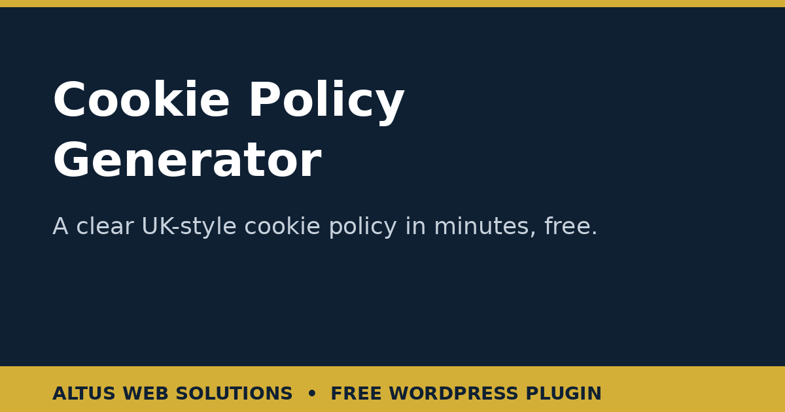

# Altus Cookie Policy Generator — Free WordPress Plugin

**A free UK-style cookie policy generator for small businesses: answer 3 short steps about the cookies your site actually uses and get a clear, honest cookie policy draft — copy it or download it, with no account needed.**

> **⬇️ Download now:** get the latest release zip from the [**Releases page**](../../releases) → WordPress → Plugins → Add New → Upload Plugin → Install Now → Activate → add the shortcode `[altus_cookie_policy_generator]` to any page.

**Keywords people search for:** cookie policy generator, free cookie policy generator UK, cookie policy template wordpress, GDPR cookie policy, website cookie policy generator, cookie policy plugin wordpress, PECR cookie consent policy, small business cookie policy, free cookie policy text, cookie banner policy page.

## What it does

If your website sets anything beyond strictly necessary cookies, UK rules expect consent first — and a clear policy explaining what you set. Most small-business sites get this wrong in one of two ways: no cookie policy at all, or a banner with nowhere explaining what visitors just accepted. Both are fixable in minutes.

Altus Cookie Policy Generator asks what your site actually uses and drafts a UK-style policy to match. Three short steps — business details, which of five cookie types the site uses (plus any named third-party services and whether a consent banner is shown) — produce a structured policy draft with your own details filled in: what cookies are, a section for each cookie type you ticked (and none you didn't), a third-party section naming your services, consent wording that matches your banner situation, how visitors can control cookies, and a contact section. Copy it onto a dedicated cookie policy page linked from your footer, or download it as .txt or .html. No account, no signup, and — in this open-source version — no email gate: everything is shown on screen, free.

> **Important:** the output is a draft template only, NOT legal or financial advice. Have it reviewed by a professional (for example a solicitor) before publishing it or relying on it, and check every section matches what your site actually does.

## Who it is for

- **Small-business owners** who have a cookie banner (or know they should) but no cookie policy page to point it at.
- **Freelancers, web designers and agencies** who need a quick, honest cookie policy draft for a client site without copy-pasting a generic template that describes cookies the site doesn't use.
- **WordPress site owners** who want a policy page that reflects their real setup — Analytics, embedded videos, a booking system — instead of a wall of boilerplate.

## The problem it solves

Generic cookie policy templates describe everything and therefore describe nothing: they claim cookies your site never sets, miss the ones it does, and read like they were written for someone else's website. A careful customer — or a regulator — notices. This generator does the opposite: it only describes what you tick. Nothing is invented, so the policy you publish is one you can stand behind, and the plain-English structure means visitors can actually understand it.

## Features — and why each one matters

### 3-step questionnaire

- **Step 1 — About your business** — business name, website address and a contact email for cookie questions. Why it matters: these head up the policy, so visitors know exactly whose cookies they are reading about.
- **Step 2 — What cookies does your site use?** — tick from five plainly explained categories, name any other services that set cookies, and say whether you show a consent banner (and which tool, if any). Why it matters: the policy is built from your answers, not from a template's guesses.
- **Step 3 — Review, then use it** — a live preview with copy and download buttons. Why it matters: you read it through and check every section matches reality before it ever goes near your website.

### Five cookie categories, honestly described

- **Strictly necessary cookies** — keep the site working: security, load balancing, remembering cookie choices. Why it matters: these are the only cookies that don't need consent, and the policy says so plainly instead of blurring the line.
- **Functional / preference cookies** — remember choices like language or region. Why it matters: visitors understand why the site remembers them, in one sentence, without jargon.
- **Analytics / performance cookies** — measure visits and traffic (for example Google Analytics, with honest examples like `_ga` and `_gid`). Why it matters: most small-business sites set these and never explain them; naming the real cookies builds trust.
- **Marketing / advertising cookies** — measure campaigns and show relevant ads elsewhere. Why it matters: this is the category visitors care most about, and hiding it is what gets businesses into trouble.
- **Embedded third-party content** — YouTube videos, maps, social feeds that set their own cookies. Why it matters: your site can set cookies through content you didn't write — the policy owns that instead of pretending otherwise.

### Honest wording, including the uncomfortable parts

- **Only ticked categories appear** — unticked types are left out entirely. Why it matters: a policy that claims cookies you don't set is as dishonest as one that omits cookies you do set.
- **Named third-party services section** — your booking system, live chat widget or other named services appear by name. Why it matters: "third parties" in the abstract tells visitors nothing; names tell them everything.
- **Consent wording that matches your banner situation** — including a plain-English warning if you have no banner but ticked non-essential cookies. Why it matters: UK rules expect consent before non-essential cookies, and a generator that silently papers over a missing banner would be doing you no favours.
- **How to control cookies** — practical guidance including aboutcookies.org. Why it matters: telling visitors how to refuse is not just good practice, it is the point of the page.
- **XSS-safe rendering** — everything you type is escaped before it appears in the preview or downloads. Why it matters: a policy page is a public page, and user input on a public page must never become executable code.

### Copy and download, on screen

- **Copy policy text** — one click, with confirmation. Why it matters: most owners paste straight into a new WordPress page, and that should take one second.
- **Download .txt and .html** — a plain-text file for records or for handing to your web person, and a formatted HTML file ready to publish. Why it matters: different owners work different ways, and a draft that only exists on screen is a draft that gets lost.

## How it works

1. Add the shortcode `[altus_cookie_policy_generator]` to a page.
2. A visitor answers step 1 (business details), step 2 (cookie types, named services, consent banner) and clicks **Generate my cookie policy**.
3. The plugin builds the structured policy entirely in the visitor's browser and shows a live preview.
4. The visitor reads it through, checks every section matches reality, then copies it or downloads it as .txt or .html — and can start over any time.

Everything happens in the browser. No account, no email address, no data sent anywhere.

## Installation (2 minutes, from the release zip)

1. Download the latest `altus-cookie-policy-generator-v1.0.0.zip` from the [**Releases page**](../../releases).
2. In WordPress, go to **Plugins → Add New → Upload Plugin**, choose the zip, click **Install Now**, then **Activate**.
3. Create or edit a page and add the shortcode: `[altus_cookie_policy_generator]`
4. Publish the page. Done — visitors can generate their cookie policy draft from it.

## Frequently asked questions

**Is the Cookie Policy Generator really free?**
Yes. Generating, copying and downloading the policy are all free, with no account needed.

**Is this legal advice?**
No. It is a draft template based on your answers, structured around UK cookie rules. Have a professional review it before publishing, and check that every section matches what your site actually does — a policy that doesn't match reality is worse than no policy.

**Do I need a cookie policy if I already have a cookie banner?**
Yes — the banner asks for consent, and the policy is the page it should point to, explaining what visitors just accepted. A banner with nowhere to explain itself is half a job.

**What if my site uses no banner but sets non-essential cookies?**
The draft says so in plain English — it includes a warning that consent should come first for non-essential cookies. Fix the banner situation on your site, then regenerate.

**Are my answers sent or stored anywhere?**
No. In this open-source version, generation happens entirely in the visitor's browser. There is no server endpoint, no database table, no email and no file write.

**Does the policy cover my privacy policy too?**
No — this is a cookie policy only. Your privacy policy (what personal data you collect and why) is a separate page; see our Privacy Policy Generator for that draft.

## Honest limits

- The output is a draft template, not legal advice and not a compliance guarantee. UK cookie rules (PECR) and data protection rules (UK GDPR) interact, and your specific setup may need professional review.
- The generator trusts your answers: if you tick a category your site doesn't use, or miss one it does, the draft will reflect your answers, not your site. Audit your site's real cookies before publishing.
- The draft does not scan your website or detect cookies automatically — it describes what you tell it.
- Cookie rules and guidance change; review the published policy whenever your site's cookies, tools or services change.

## Changelog

### 1.0.0

First public release (stripped open-source version). 3-step questionnaire; five cookie categories with honest examples; named third-party services; consent-banner wording including the no-banner warning; live preview; copy and .txt/.html download. Email gate, lead storage and email sending removed — the full draft is shown on screen.

## What data does this tool handle?

This GitHub version contains NO lead capture, NO email sending, and NO data storage — results are shown on screen only. The version hosted on altuswebsolutions.com may offer email delivery; this open-source version does not. The visitor's business details and answers never leave their browser: there is no server endpoint in this version, no database table is created, no file is written on the server, and nothing is transmitted to any external service. Note: the business contact email the visitor types in step 1 is shown inside their own generated policy draft (that is its purpose) — it is not sent anywhere by this plugin.

## Disclaimer

This software is provided free of charge, "as is", WITHOUT warranty of any kind, express or implied, including but not limited to the warranties of merchantability and fitness for a particular purpose. The authors are NOT liable for any loss, damage or cost arising from the use of this software, including but not limited to regulatory action, fines, or legal costs. The generated document is a draft template only and NOT legal or financial advice; have it reviewed by a professional where it matters. Always back up your WordPress site before installing any plugin, and test new plugins on a staging site where possible.

## Licence

GPLv2 or later. See [LICENSE](LICENSE).
